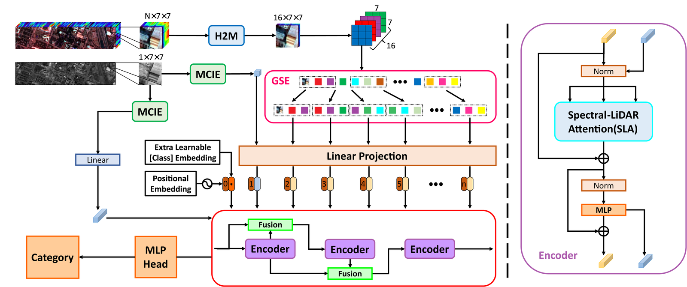
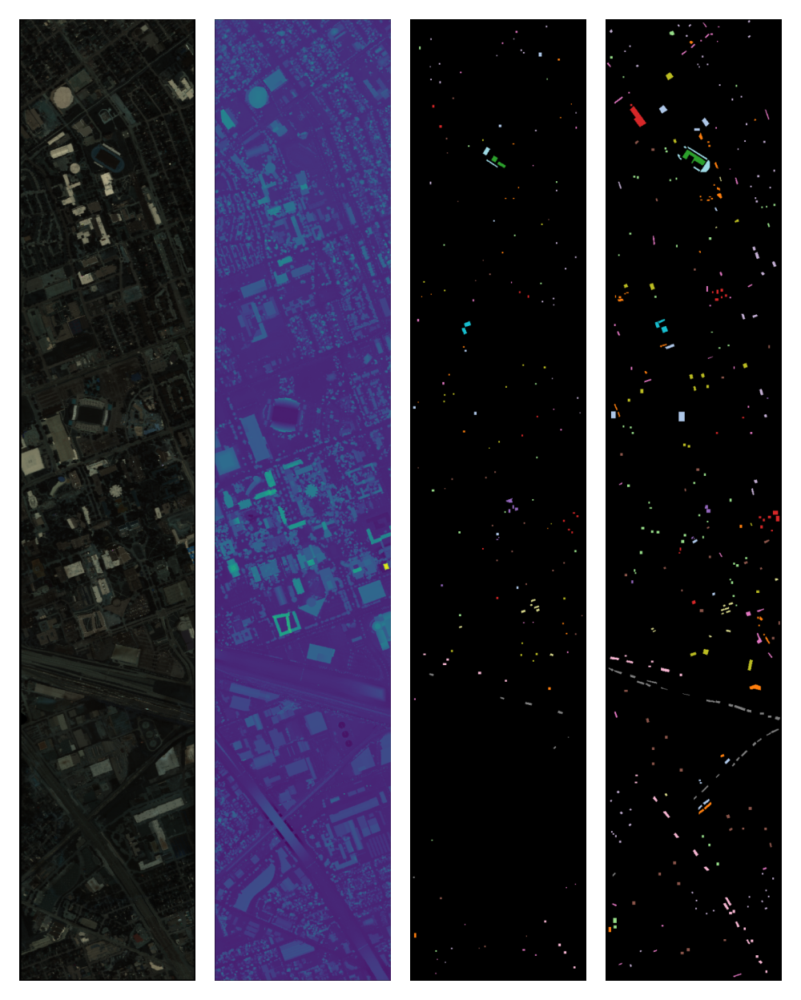
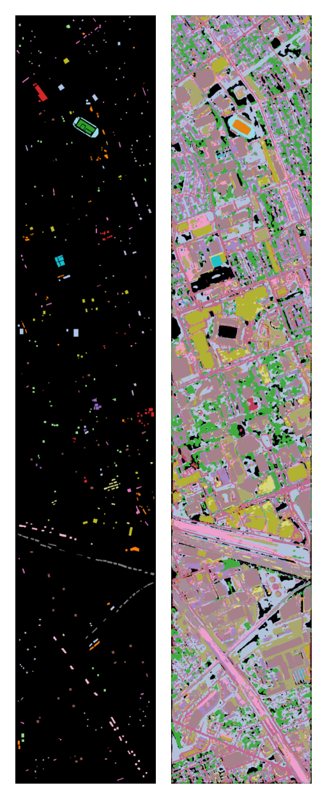

<div align="center">

# LSLFormer

### A Lightweight Spectral–LiDAR Fusion Network for Remote Sensing Image Classification

**Dian Li** · **Siyuan Hao** · **Cheng Fang** · **Yuanxin Ye**

*IEEE Transactions on Geoscience and Remote Sensing*, vol. 64, 2026

[](https://ieeexplore.ieee.org/abstract/document/11352989)
[](https://doi.org/10.1109/TGRS.2026.3654154)
[](#installation)
[](#installation)
[](LICENSE)

Official PyTorch implementation of **LSLFormer**, a lightweight transformer for fusing hyperspectral images (HSI) and LiDAR data in land-cover classification.

</div>

---

## 📖 Overview

HSI carries rich, continuous spectral signatures but suffers from limited spatial resolution and high band redundancy; LiDAR provides precise elevation and structural cues that are complementary to spectra. Fusing the two should therefore be a win — yet Transformer-based fusion models are usually trapped between **accuracy** and **cost**: self-attention is quadratic in sequence length, and high-dimensional spectra make that length explode.

LSLFormer is built around a single question: *can we keep the accuracy of cross-modal attention while paying a CNN-level computational budget?* Its answer is a 3-layer spectral transformer (only **20.5 K parameters**, **26.8 M FLOPs**) in which every heavy operation is replaced by a physically or structurally motivated lightweight counterpart:

- **H2M** aggregates 144 hyperspectral bands into 16 "virtual multispectral" bands with learnable spectral response functions, so self-attention operates on a sequence 9× shorter.
- **MCIE** extracts multi-scale structural features from LiDAR with three progressive depth-wise branches at a cost of 0.73 K parameters.
- **SLA** fuses the spectral attention map with a LiDAR-derived structural affinity map through a single 1×1 convolution, injecting geometry into attention itself.
- **CMSC** distils the LiDAR affinity distribution into the HSI features by KL divergence, sharpening object boundaries without touching inference cost.

<div align="center">

<br>
<sub><b>Figure 1.</b> Overview of LSLFormer. HSI and LiDAR patches go through H2M and MCIE respectively, are embedded as spectral tokens, and are fused by three encoder stages whose attention is guided by the LiDAR structural stream (right: one encoder block).</sub>
</div>

---

## ✨ Highlights

| Feature | What it gives you |
|:--|:--|
| **Up to 47× fewer parameters** | 20.51 K parameters / 26.82 M FLOPs — about **2 % of the parameters and 10 % of the FLOPs of FrIT**, while being 3.25 OA points more accurate on Houston 2013. |
| **Physics-inspired band reduction** | H2M learns virtual SRFs under a non-negativity/normalisation constraint, instead of blind PCA or clustering. |
| **Geometry inside attention** | SLA normalises a LiDAR affinity matrix and mixes it with the spectral attention map via a learnable 1×1 gate, rather than concatenating features late. |
| **Boundary-aware training** | CMSC aligns the pixel-to-pixel topology of HSI and LiDAR features as a KL-divergence regulariser (λ = 0.01); it is used **only during training**. |
| **Tiny patches, few layers** | 7 × 7 patches and 3 encoder layers, so it runs on a single 8 GB consumer GPU. |
| **Consistent across benchmarks** | Best OA **and** κ among eight CNN/Transformer baselines on Houston 2013, MUUFL and Trento. |

---

## 🧠 Method

### Components

| Module | Location | Role |
|:--|:--|:--|
| `H2M` | `model.py` | Learnable spectral response functions (16 × 144), implemented as a normalised, clamped 1×1 convolution: `Clamp(Conv1×1(H) / Σθ, [0,1])`. |
| `MCIE` | `model.py` | 1×1 compression → three channel groups with 1×1 / 3×3 / 5×5 kernels, progressively chained (`s2+Y1`, `s3+Y2`), GroupNorm + LeakyReLU, 1×1 fusion. |
| `Attention` (SLA) | `model.py` | Spectral self-attention `QKᵀ/√d` concatenated with the LiDAR affinity `softmax(X_L X_Lᵀ/√d)`, mixed by a 1×1 conv over the 2-channel attention tensor, then applied to `V`. |
| `Transformer` | `model.py` | 3 encoder stages; a 1×2 convolution fuses the current stage features with those of the previous stage. |
| `CMSCLoss` | `loss.py` | Temperature-scaled cosine affinity of HSI and LiDAR features, aligned with `KLDivLoss` (`batchmean`, τ = 0.1). |
| `LSLF` | `model.py` | Full network: H2M → GSE-style band grouping → token embedding → 3 SLA encoders → CLS → MLP head. |

<div align="center">

<br>
<sub><b>Figure 2.</b> Spectral–LiDAR Attention. The spectral attention map <i>A<sub>S</sub></i> and the LiDAR structural affinity <i>A<sub>L</sub></i> are concatenated and fused by a 1×1 convolution, which acts as a learnable gate between spectral similarity and geometric continuity.</sub>
</div>

### Default configuration

| Setting | Value |
|:--|:--|
| Input patch | 7 × 7 (HSI 144 bands + LiDAR 1 band) |
| H2M output bands | 16 |
| Band neighbourhood (`--band_patches`) | 3 |
| Embedding dim / depth / heads | 16 / 3 / 4 |
| MLP hidden dim | 8 |
| Dropout / embedding dropout | 0.1 / 0.1 |
| Parameters / FLOPs | 20.51 K / 26.82 M |

> **Naming.** In the paper, the whole cross-modal attention block is called **SLA**; in the code it is the `Attention` class inside `Transformer`, where the LiDAR affinity is built from the features produced by `MCIE`.

---

## 📊 Results

### Classification accuracy

OA / AA / κ (%) on three benchmarks; **bold** marks the best. Per-class accuracies are reported in the paper.

| Method | Houston 2013 OA | AA | κ | MUUFL OA | AA | κ | Trento OA | AA | κ |
|:--|:--:|:--:|:--:|:--:|:--:|:--:|:--:|:--:|:--:|
| 1D-CNNs | 85.72 | 87.51 | 84.50 | 91.55 | 81.67 | 88.83 | 96.60 | 94.23 | 95.48 |
| 2D-CNNs | 86.07 | 88.09 | 86.58 | 91.87 | 84.09 | 89.23 | 96.66 | 94.00 | 95.54 |
| CCR-Net | 87.64 | 88.85 | 78.15 | 85.99 | 66.18 | 87.90 | 97.81 | 94.66 | 97.09 |
| ViT | 83.39 | 86.09 | 85.20 | 90.94 | 76.00 | 92.19 | 94.35 | 86.46 | 92.47 |
| SpectralFormer | 86.37 | 87.54 | 79.26 | 90.05 | 78.41 | 86.78 | 95.13 | 93.06 | 93.56 |
| FrIT | 88.90 | 90.84 | 87.95 | 92.35 | **87.86** | 89.90 | 96.24 | 93.61 | 94.99 |
| S2ATNet | 87.51 | 89.11 | 86.45 | 92.51 | 86.00 | 90.10 | 98.38 | 97.11 | 97.83 |
| MobileViTv2 | 86.62 | 87.76 | 85.47 | 90.23 | 78.48 | 86.97 | 96.66 | 94.62 | 95.54 |
| **LSLFormer (ours)** | **92.15** | **92.92** | **91.48** | **94.40** | 87.57 | **92.62** | **99.34** | **98.45** | **99.12** |

LSLFormer leads in OA and κ on **all three** datasets. The single exception is MUUFL AA, where FrIT is 0.29 points higher while LSLFormer keeps a 2.05-point OA advantage — FrIT is stronger on the rare classes, LSLFormer on the dataset as a whole.

### Accuracy vs. cost

<div align="center">

<br>
<sub><b>Figure 3.</b> OA vs. FLOPs on Houston 2013; marker area is proportional to parameter count. LSLFormer sits in the upper-left corner: highest OA with the smallest budget.</sub>
</div>

| Method | Params (K) | OA (%) |
|:--|:--:|:--:|
| LSLFormer | **20.51** | **92.15** |
| 1D-CNNs | 31.8 | 85.72 |
| CCR-Net | 67.9 | 87.64 |
| MobileViTv2 | 76.3 | 86.62 |
| 2D-CNNs | 81.2 | 86.07 |
| ViT | 99.4 | 83.39 |
| SpectralFormer | 227.9 | 86.37 |
| S2ATNet | 258.9 | 87.51 |
| FrIT | 974.9 | 88.90 |

On FLOPs, LSLFormer needs **26.82 M** against **268.59 M** for FrIT — roughly one tenth, while being 3.25 OA points more accurate. FLOPs for the remaining baselines are plotted in Fig. 3.

> Parameter and FLOP counts are those reported in the paper. A direct `torch` count gives **23.14 K** parameters in total; the 20.51 K figure excludes the H2M SRF kernel (2,304) and the positional/class tokens (304).

### Ablation study (Houston 2013)

Each module is removed from the full model (`×` = removed, `✓` = kept).

| H2M | MCIE | SLA | CMSC | OA (%) | AA (%) | κ (%) |
|:--:|:--:|:--:|:--:|:--:|:--:|:--:|
| × | × | × | × | 82.85 | 83.51 | 81.37 |
| × | ✓ | ✓ | ✓ | 87.19 | 87.28 | 86.09 |
| ✓ | × | ✓ | ✓ | 87.48 | 88.35 | 86.40 |
| ✓ | ✓ | × | ✓ | 87.63 | 88.74 | 86.56 |
| ✓ | ✓ | ✓ | × | 88.64 | 89.37 | 87.66 |
| ✓ | ✓ | ✓ | ✓ | **92.15** | **92.92** | **91.48** |

Removing **H2M** costs the most among the single-module variants (4.96 OA), followed by MCIE (4.67), SLA (4.52) and CMSC (3.51); dropping all four collapses to 82.85 OA, i.e. a plain ViT-style fusion.

### Spectral downsampling alternatives (Houston 2013, 144 → 16 bands)

| Method | OA (%) | AA (%) | κ (%) |
|:--|:--:|:--:|:--:|
| PCA | 78.98 | 79.04 | 77.21 |
| SPA | 86.40 | 87.36 | 85.23 |
| Cor | 87.68 | 87.52 | 86.61 |
| K-means | 87.72 | 88.72 | 86.66 |
| **H2M (ours)** | **92.15** | **92.92** | **91.48** |

### Module-level cost

| Module | Params (K) | Params (%) | FLOPs (M) | FLOPs (%) |
|:--|:--:|:--:|:--:|:--:|
| H2M | 2.30 | 11.2 | 7.23 | 26.9 |
| MCIE | 0.73 | 3.5 | 1.54 | 5.8 |
| SLA | 14.00 | 68.3 | 13.43 | 50.1 |
| Others | 3.48 | 17.0 | 4.62 | 17.2 |
| **Total** | **20.51** | **100** | **26.82** | **100** |

SLA dominates the budget, but it is cheap in absolute terms precisely because H2M has already shortened the spectral sequence.

### Qualitative results

<div align="center">
<table>
<tr>
<td align="center" width="66%"></td>
<td align="center" width="34%"></td>
</tr>
<tr>
<td align="center"><sub><b>Figure 4.</b> Houston 2013: pseudo-colour HSI (bands 70/50/30), LiDAR, and the training / testing ground truth.</sub></td>
<td align="center"><sub><b>Figure 5.</b> Annotated ground truth (left) vs. LSLFormer prediction over the full scene (right), OA 92.15 %.</sub></td>
</tr>
</table>
</div>

---

## 📁 Repository structure

```text
LSLFormer/
├── model.py                  # H2M, MCIE, SLA (Attention), Transformer encoder, LSLF
├── loss.py                   # CMSCLoss — KL-divergence structural distillation
├── train.py                  # Training / evaluation entry point (argparse)
├── log/
│   └── houston2013.pt        # Released checkpoint for Houston 2013
├── Figure/                   # Architecture, SLA, dataset, prediction, cost figures
├── requirements.txt
├── LICENSE                   # MIT
└── README.md
```

---

<a id="installation"></a>

## ⚙️ Installation

```bash
conda create -n lslformer python=3.10 -y
conda activate lslformer

# PyTorch matching your CUDA version (the paper uses 2.5.1)
pip install torch torchvision --index-url https://download.pytorch.org/whl/cu121

pip install -r requirements.txt
```

Requirements: **Python 3.10** and **PyTorch ≥ 2.0** (paper: 3.10.16 / 2.5.1). All experiments were run on a single **NVIDIA RTX 4060 (8 GB)**; the model also trains on CPU for debugging.

---

## 🗂️ Data preparation

The Houston 2013 dataset used in the paper can be downloaded from:

| Platform | Link | Note |
|:--|:--|:--|
| Google Drive | [Download](https://drive.google.com/drive/folders/1Op5O5UhlPWZK6ng9IYT1MzBftsool7jt?usp=drive_link) | Public |
| Baidu Netdisk | [Download](https://pan.baidu.com/s/1T5m8ADyHL0gSkzIh8bp8dg) | Code: `f391` |

Place the files exactly as follows — `train.py` reads these two paths and these `.mat` keys:

```text
LSLFormer/
└── Data/
    └── houston2013/
        ├── hsi_houston2013.mat     # 'input' (H, W, 144), 'TR', 'TE' (H, W) label maps
        └── lidar_houston2013.mat   # 'LiDAR_data' (H, W) or (H, W, 1)
```

| Dataset | Scene | Bands | Wavelength | Classes | Train / Test | Sensors |
|:--|:--|:--:|:--|:--:|:--:|:--|
| **Houston 2013** | 349 × 1905 | 144 | 380–1050 nm | 15 | 2,832 / 12,197 | CASI + LiDAR (1 band) |
| MUUFL | 325 × 220 | 64 | 375–1050 nm | 11 | 13,417 / 40,270 | ROSIS + Gemini ALTM (2 bands) |
| Trento | 600 × 166 | 63 | 420–990 nm | 6 | 1,508 / 28,706 | AISA Eagle + Optech ALTM |

> ⚠️ **Only the Houston 2013 loader is currently released.** `train.py` raises `ValueError` for any other `--dataset` value; the class colour maps for MUUFL and Trento are already present, so adding a data branch (same `.mat` keys) is enough to reproduce the remaining two columns of the results table.

---

## 🚀 Training

```bash
python train.py \
    --dataset houston2013 \
    --flag_test train \
    --patches 7 --band_patches 3 \
    --batch_size 64 --learning_rate 5e-4 --weight_decay 5e-3 \
    --gamma 0.9 --test_freq 10 --seed 0
```

**Key settings** (paper values; defaults in `train.py`)

| Argument | Paper | Meaning |
|:--|:--:|:--|
| `--patches` | 7 | Spatial patch size |
| `--band_patches` | 3 | Spectral neighbourhood used by the band-grouping embedding |
| `--batch_size` | 64 | Mini-batch size |
| `--learning_rate` | 5e-4 | Adam initial learning rate |
| `--weight_decay` | 5e-3 | Adam weight decay |
| `--gamma` | 0.9 | StepLR decay factor (step size = `epochs / 10`) |
| `--test_freq` | 10 | Validation interval (code default 5) |
| `--epoches` | 600 / 500 / 200 | Houston 2013 / MUUFL / Trento |
| `--seed` | 0 | Random seed (also fixes `cudnn` determinism) |

**Outputs**

```text
log/houston2013.pt    # checkpoint, saved whenever validation AA improves
```

> 💡 The number of epochs is fixed inside `train.py` per dataset (`args.epoches = 600` for Houston 2013), so the `--epoches` flag is overridden for that dataset.
>
> 💡 The CMSC weight is hard-coded as `0.01 * CMSCLoss(...)` in both the training and validation loops, matching λ = 0.01 in the paper.
>
> 💡 `--dim_reduction {h2m,var,kmeans,cor,pca,spa}` is **reserved**: only `h2m` is wired into the model. The PCA / SPA / Cor / K-means rows of the downsampling comparison were produced by swapping the front-end offline.

---

## 🔍 Evaluation

The released checkpoint `log/houston2013.pt` can be evaluated directly:

```bash
python train.py --dataset houston2013 --flag_test test
```

It reports OA / AA / κ together with a per-class classification report, and writes the full-scene prediction map to `prediction map/lslf_houston2013.png`. Expected output on the released checkpoint (Houston 2013):

```text
Final Test Results:
Test OA: 0.9215 | AA: 0.9292 | Kappa: 0.9148
```
---

## 📐 Metrics

All metrics are computed from the confusion matrix in `cal_results()` (`train.py`).

| Metric | Definition | Note |
|:--|:--|:--|
| **OA** ↑ | `Σ diag(M) / Σ M` | Overall accuracy over all test pixels |
| **AA** ↑ | `mean_i(M_ii / Σ_j M_ij)` | Mean per-class accuracy; sensitive to rare classes |
| **κ** ↑ | `(OA − p_e) / (1 − p_e)`, `p_e = Σ_i(row_i · col_i) / N²` | Agreement corrected for chance |

---

## 📝 Citation

If you find this work useful, please consider citing:

```bibtex
@article{li2026lslformer,
  title   = {LSLFormer: A Lightweight Spectral--LiDAR Fusion Network for Remote Sensing
             Image Classification},
  author  = {Li, Dian and Hao, Siyuan and Fang, Cheng and Ye, Yuanxin},
  journal = {IEEE Transactions on Geoscience and Remote Sensing},
  volume  = {64},
  pages   = {5501712},
  year    = {2026},
  doi     = {10.1109/TGRS.2026.3654154}
}
```

---

## 🙏 Acknowledgements

- The **Houston 2013** dataset from the 2013 IEEE GRSS Data Fusion Contest, and the **MUUFL** and **Trento** benchmarks.
- [SpectralFormer](https://github.com/danfenghong/IEEE_TGRS_SpectralFormer) for the group-wise spectral embedding idea that LSLFormer builds upon.
- [vit-pytorch](https://github.com/lucidrains/vit-pytorch) for the PreNorm / Residual block conventions the encoder follows.

---

## ⚖️ License

This project is released under the [MIT License](LICENSE).

```text
Copyright (c) 2026 Dian Li, Siyuan Hao, Cheng Fang, Yuanxin Ye
```

## 📬 Contact

**Dian Li** — [alidnnn@163.com](mailto:alidnnn@163.com) · GitHub: [@DianLi2002](https://github.com/DianLi2002)

For questions about the code, please open an issue. For questions about the paper, feel free to reach out by email.
